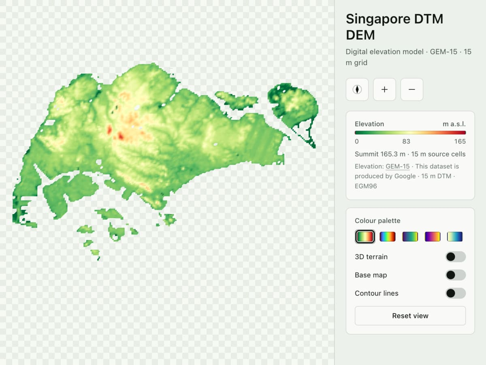
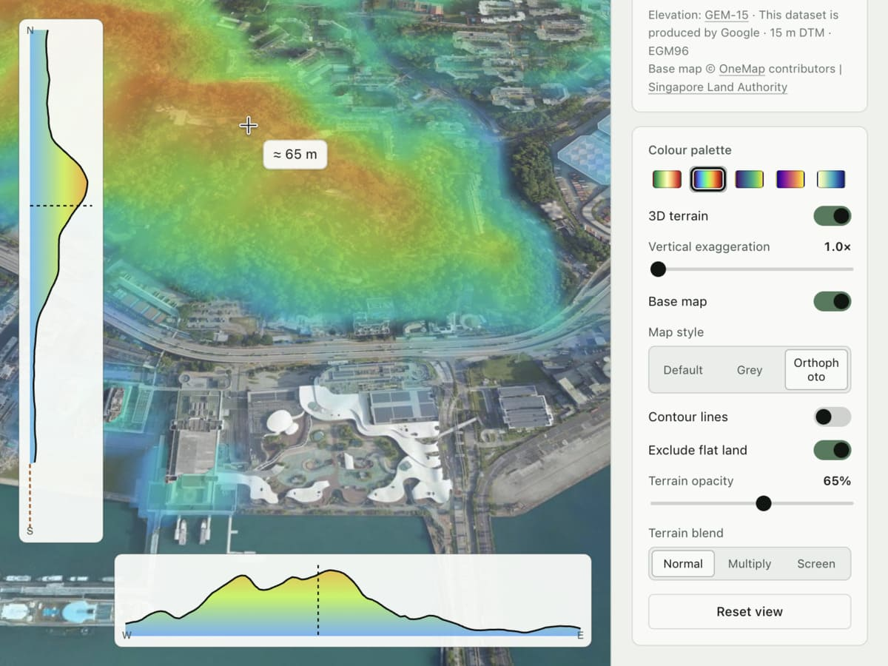
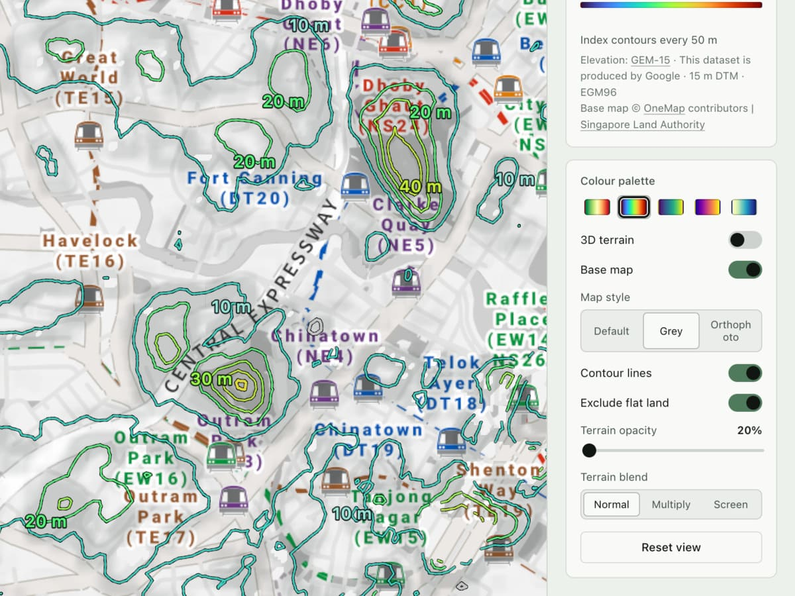

# Singapore DTM DEM

An interactive 3D terrain of Singapore, built from Google's 15 m GEM-15 digital terrain model and rendered with three.js.







## Features

- 3D relief of the whole island, with five colour ramps and a 10 m contour mode.
- Hover cross-sections: north–south and east–west profiles for the point under the cursor, using the terrain's own colours.
- OneMap base map in Default, Grey and Orthophoto styles, with opacity and blend controls.
- Flat 2D map or tilted 3D view, with adjustable vertical exaggeration.
- Streams only the terrain needed for the current view from a 13.6 MB Cloud-Optimised GeoTIFF.

## Development

### Generate GeoTIFF
```bash
python3 -m venv .venv
.venv/bin/python -m pip install rasterio pyproj numpy requests
.venv/bin/python pipeline/gem15_singapore.py
```

### Run dev server

```
npm install
npm run dev
# → http://localhost:8123/
```

## Deploy to GitHub Pages

Pushes to `main` build and publish the site automatically. In the repository
settings, set **Pages → Build and deployment → Source** to **GitHub Actions**.
You can also run the workflow manually from the Actions tab.

## Data and attribution

**Elevation — GEM-15.** Google's Near-Global Elevation Models at 15 m, DTM band, EGM96 orthometric metres. Licensed under [CC BY 4.0](https://creativecommons.org/licenses/by/4.0/).

**This dataset is produced by Google.**

The data was cropped to Singapore, masked to the national boundary and outlying islands, and converted to a Cloud-Optimised GeoTIFF; those are the changes made for this viewer.

Citation: Batchu, V. V., Neumann, M., Li, T., Allen, B., Zhang, J., & Van Arsdale, C. (2026). *GEM-15: Global surface and terrain elevation models (15 meters) from sub-meter optical stereo imagery.* EarthArXiv. [doi:10.31223/X55N75](https://doi.org/10.31223/X55N75)

- Dataset: [GEM-15 on Earth Engine](https://developers.google.com/earth-engine/datasets/catalog/projects_climate-and-sustainability_assets_gem-15_v1)
- Base map: [OneMap](https://www.onemap.gov.sg/), © OneMap contributors | [Singapore Land Authority](https://www.sla.gov.sg/)


